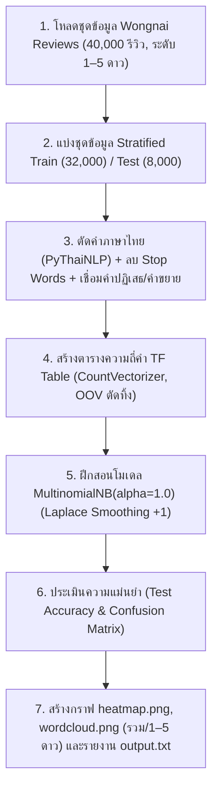
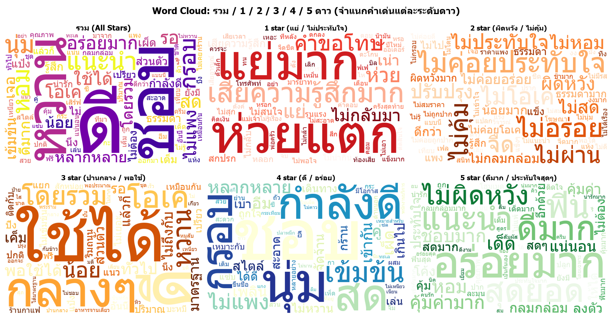
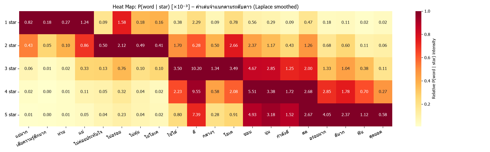
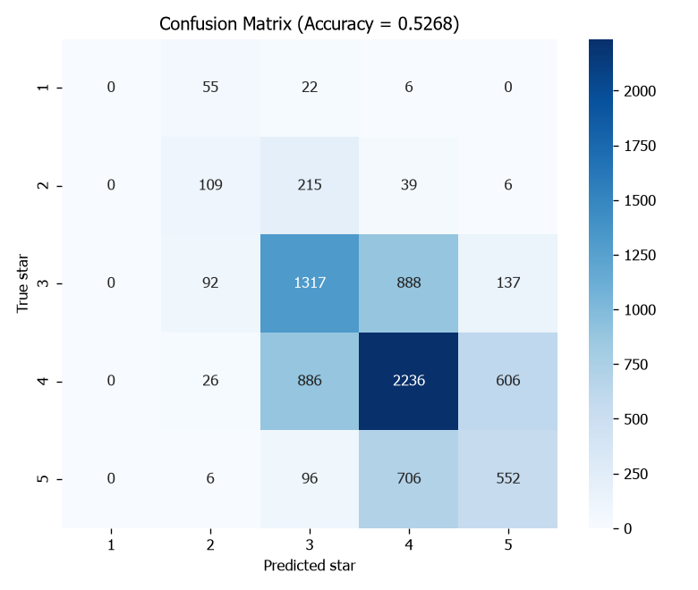

<div align="center">

# ⭐ ระบบวิเคราะห์ความรู้สึกและทำนายระดับดาวรีวิวร้านอาหารด้วย Naive Bayes (Wongnai Reviews Edition)


<br/>


-2EA44F?style=for-the-badge&logo=checkmarx&logoColor=white)

</div>

โครงงานการประยุกต์ใช้ **Multinomial Naive Bayes (`alpha=1.0` Laplace Smoothing)** สำหรับวิเคราะห์ความรู้สึก (Sentiment Analysis) และทำนายระดับดาว (**1 ถึง 5 ดาว**) จากชุดข้อมูลรีวิวร้านอาหารภาษาไทย **`Highgroundbkk/wongnai_reviews`** บน Hugging Face จำนวน **40,000 รีวิว** พร้อมจำลองโจทย์คำนวณ Naive Bayes บนกระดานแบบละเอียดทุกขั้นตอน:

1. **การจำลองโจทย์คำนวณ Naive Bayes บนกระดาน (Whiteboard Toy Example)**: แสดงขั้นตอนการตัด Stop Words (`this`), การทำ Stemming (`loves` $\rightarrow$ `love`, `hates` $\rightarrow$ `hate`), การจัดการคำนอกคลังคำศัพท์ (`OOV`: `John`), ตารางความถี่คำ (`TF Table`), การทำ Laplace Smoothing (`+1`) และการคำนวณความน่าจะเป็นตัดสินคลาส `Y` เทียบกับ `N`
2. **การจำแนกความคิดเห็นรีวิวภาษาไทย 1–5 ดาว (Pure Multinomial Naive Bayes - No Rebalance)**: ประมวลผลข้อความภาษาไทยด้วย `PyThaiNLP`, คงคำสื่ออารมณ์/คำปฏิเสธ (`ไม่อร่อย`, `ไม่ประทับใจ`, `อร่อยมาก`, `แย่มาก`), สร้างตาราง `CountVectorizer` และฝึกสอนโมเดล `MultinomialNB(alpha=1.0)` บนสัดส่วนข้อมูลจริงโดยไม่ใช้การสุ่มซ้ำปรับสมดุล (No Rebalance)

---

## 🧠 1. การออกแบบขั้นตอนการทำงาน (Pure Naive Bayes Pipeline - No Rebalance)

ระบบนี้ออกแบบตามขั้นตอนบนกระดานอย่างเคร่งครัด โดยใช้ **`MultinomialNB(alpha=1.0)`** จาก `scikit-learn` บนข้อมูลจริงทั้ง **40,000 รีวิว** (แบ่ง `Train 80% : Test 20%` แบบ Stratified):

* **Tokenization & Thai Normalization**: ตัดคำภาษาไทยด้วย `pythainlp.tokenize.word_tokenize` (`engine="newmm"`) และลดรูปตัวอักษรซ้ำ (เช่น `"อร่อยยยย"` $\rightarrow$ `"อร่อย"`)
* **Sentiment-Aware Stop Words Removal**: กรองคำเชื่อมทั่วไปออกด้วย `thai_stopwords()` แต่**เก็บรักษาคำสื่ออารมณ์และคำปฏิเสธ** (`ไม่`, `ไม่ได้`, `ไม่มี`, `ไม่ค่อย`, `ดี`, `มาก`, `น้อย`, `แย่`, `คุ้ม`, `ประทับใจ`, `ผิดหวัง`, `ห่วย`) และเชื่อมคำปฏิเสธ/คำขยายเข้าด้วยกัน (เช่น `"ไม่" + "อร่อย"` $\rightarrow$ `"ไม่อร่อย"`, `"อร่อย" + "มาก"` $\rightarrow$ `"อร่อยมาก"`)
* **Term Frequency (TF) Vectorization**: แปลงข้อความเป็นเมทริกซ์ความถี่ด้วย `CountVectorizer` (`ngram_range=(1, 2)`, `max_features=30,000`) โดยคำที่ไม่เคยพบในชุดฝึกสอน (`OOV`) จะถูกเพิกเฉยโดยอัตโนมัติในขั้นตอนทดสอบ
* **Laplace Smoothing ($\alpha = 1.0$)**: คำนวณความน่าจะเป็นของแต่ละคำในแต่ละระดับดาวด้วย `MultinomialNB(alpha=1.0)` เพื่อป้องกันปัญหาความน่าจะเป็นเป็นศูนย์ (Zero-Frequency Problem)



---

## 📐 2. สูตรการคำนวณ Naive Bayes และโจทย์ตัวอย่างบนกระดาน (Whiteboard Example)

### 2.1 สมการหลักของ Multinomial Naive Bayes และ Laplace Smoothing (`+1`)

$$\hat{P}(c \mid d) \propto P(c) \prod_{w \in d} P(w \mid c), \qquad P(w \mid c) = \frac{\text{TF}(w, c) + 1}{N_c + |V|}$$

* $P(c)$: ความน่าจะเป็นตั้งต้น (Prior Probability) ของคลาส $c$
* $\text{TF}(w, c)$: ความถี่ของคำ $w$ ในคลาส $c$
* $|V|$: ขนาดคลังคำศัพท์ทั้งหมด (Vocabulary Size)
* **OOV (Out-of-Vocabulary)**: คำที่ไม่อยู่ใน $V$ จะไม่ถูกนำมาคูณในสมการ

### 2.2 การคำนวณโจทย์ตัวอย่างบนกระดานทีละขั้นตอน

* **Training Set**:
  1. `"I love this product."` $\rightarrow$ **`Y`**
  2. `"He loves this product."` $\rightarrow$ **`Y`**
  3. `"She hates this product."` $\rightarrow$ **`N`**
* **Test Sentence**: `"John love this product"` $\rightarrow$ **`Y / N`**
  * `"John"` = **OOV** (ตัดทิ้ง)
  * `"this"` = **Stop Word** (ตัดทิ้ง)
  * คำที่ใช้คำนวณ: **`["love", "product"]`**
* **Vocabulary หลังตัด Stop Word (`this`) และทำ Stemming (`loves` $\rightarrow$ `love`, `hates` $\rightarrow$ `hate`)**:
  * $V = \{\text{I}, \text{love}, \text{product}, \text{He}, \text{She}, \text{hate}\}$ ($|V| = 6$)

| คลาส (Class) | $P(\text{Class})$ | `I` | `love` | `product` | `He` | `She` | `hate` |
| :---: | :---: | :---: | :---: | :---: | :---: | :---: | :---: |
| **`Y`** | $\frac{2}{3}$ | $\frac{1+1}{2+6} = \frac{2}{8}$ | $\mathbf{\frac{2+1}{2+6} = \frac{3}{8}}$ | $\mathbf{\frac{2+1}{2+6} = \frac{3}{8}}$ | $\frac{1+1}{2+6} = \frac{2}{8}$ | $\frac{0+1}{2+6} = \frac{1}{8}$ | $\frac{0+1}{2+6} = \frac{1}{8}$ |
| **`N`** | $\frac{1}{3}$ | $\frac{0+1}{1+6} = \frac{1}{7}$ | $\mathbf{\frac{0+1}{1+6} = \frac{1}{7}}$ | $\mathbf{\frac{1+1}{1+6} = \frac{2}{7}}$ | $\frac{0+1}{1+6} = \frac{1}{7}$ | $\frac{1+1}{1+6} = \frac{2}{7}$ | $\frac{1+1}{1+6} = \frac{2}{7}$ |

$$P(Y \mid \text{test}) \propto \left(\frac{2}{3}\right)\left(\frac{3}{8}\right)\left(\frac{3}{8}\right) = \mathbf{0.094} \quad > \quad P(N \mid \text{test}) \propto \left(\frac{1}{3}\right)\left(\frac{1}{7}\right)\left(\frac{2}{7}\right) = \mathbf{0.014} \implies \text{ตอบคลาส } \mathbf{Y}$$

---

## 📊 3. ผลลัพธ์จากการรันจริง (Dataset: `Highgroundbkk/wongnai_reviews` — 40,000 รีวิว)

### 3.1 ตารางสรุปประสิทธิภาพและคำเด่นจำแนกตามระดับดาว (1–5 ดาว)

| ระดับดาว (Star) | จำนวนข้อมูลทั้งหมด | จำนวนข้อมูล Test (20%) | Precision | Recall | F1-Score | คำเด่นประจำระดับดาว (Top Distinctive Words) |
| :---: | :---: | :---: | :---: | :---: | :---: | :--- |
| **1 ดาว (⭐)** | 415 รีวิว | 83 รีวิว | 0.00 | 0.00 | 0.00 | `ห่วยแตก`, `แย่มาก`, `เสียความรู้สึกมาก`, `คำขอโทษ`, `ห่วย`, `แย่`, `ไม่กลับมา`, `เน่า`, `สกปรก` |
| **2 ดาว (⭐⭐)** | 1,845 รีวิว | 369 รีวิว | 0.38 | 0.30 | 0.33 | `ไม่ค่อยประทับใจ`, `ไม่อร่อย`, `ไม่คุ้ม`, `ไม่โอเค`, `ไม่ผ่าน`, `จืด`, `ปรับปรุง`, `ผิดหวัง`, `ไม่หอม` |
| **3 ดาว (⭐⭐⭐)** | 12,171 รีวิว | 2,434 รีวิว | 0.52 | 0.54 | 0.53 | `ใช้ได้`, `ดี`, `กลางๆ`, `โอเค`, `โดยรวม`, `หวาน`, `น้อย`, `พอใช้ได้`, `ทั่วไป`, `มาตรฐาน` |
| **4 ดาว (⭐⭐⭐⭐)** | 18,770 รีวิว | 3,754 รีวิว | 0.58 | 0.60 | 0.59 | `ชอบ`, `นุ่ม`, `กำลังดี`, `สด`, `กรอบ`, `เข้มข้น`, `ไม่แพง`, `หลากหลาย`, `สะอาด`, `เข้ากัน` |
| **5 ดาว (⭐⭐⭐⭐⭐)** | 6,799 รีวิว | 1,360 รีวิว | 0.42 | 0.41 | 0.41 | `อร่อยมาก`, `ดีมาก`, `ฟิน`, `สุดยอด`, `แนะนำ`, `ไม่ผิดหวัง`, `คุ้มค่ามาก`, `หอม`, `ชอบมาก`, `เด็ด` |
| **ภาพรวม (Overall)** | **40,000 รีวิว** | **8,000 รีวิว** | **0.52** | **0.53** | **0.52** | **Test Accuracy = 0.5268 (52.68%)** |

---

### 3.2 กราฟแสดงผลลัพธ์ (Visualizations)

#### 1) Word Cloud: รวม / 1 / 2 / 3 / 4 / 5 ดาว (`wordcloud.png`)


#### 2) Heat Map: ความน่าจะเป็น $P(\text{word} \mid \text{star})$ ของคำเด่นแต่ละระดับดาว (`heatmap.png`)


#### 3) Confusion Matrix & Performance Test Accuracy (`confusion_matrix.png`)


---

## 🚀 4. วิธีการติดตั้งและรันโปรแกรม

```powershell
# 1. ติดตั้งไลบรารีที่จำเป็น
pip install -r requirements.txt

# 2. รันโปรแกรมประมวลผล Naive Bayes, บันทึกรายงาน output.txt และสร้างกราฟอัตโนมัติ
python app.py
```

---

## 📁 5. โครงสร้างไฟล์ในโปรเจกต์

```text
d:\NB\
├── app.py                      # โค้ดหลักประมวลผล Naive Bayes (Part A โจทย์บนกระดาน + Part B Wongnai 1–5 ดาว)
├── output.txt                  # รายงานผลลัพธ์การคำนวณ ตาราง TF, Classification Report และคำเด่นแต่ละดาว
├── wordcloud.png               # กราฟ Word Cloud จำแนกคำเด่นครบทั้ง รวม / 1 / 2 / 3 / 4 / 5 ดาว
├── heatmap.png                 # กราฟ Heat Map ความน่าจะเป็น P(word | star) (Laplace Smoothed)
├── confusion_matrix.png        # กราฟ Confusion Matrix และค่า Test Accuracy
├── requirements.txt            # รายการไลบรารีที่ใช้ในโปรเจกต์
├── .gitignore                  # ตั้งค่าไฟล์ที่ยกเว้นการติดตามใน Git
└── README.md                   # เอกสารอธิบายโครงงาน ทฤษฎี และสรุปผลการทดลอง
```

